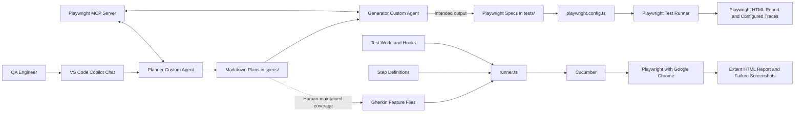

# Playwright TestFlow

### Agent-Assisted Test Planning, Generation & Execution

[](https://playwright.dev/)
[](https://cucumber.io/)
[](https://www.typescriptlang.org/)
[](https://github.com/features/copilot)
[](https://github.com/microsoft/playwright-mcp)

**Playwright TestFlow** is a TypeScript-based, agent-assisted browser automation framework that brings together test planning, test generation, and test execution through a structured workflow.

Built with Playwright, Cucumber, GitHub Copilot custom agents, and Playwright MCP, the project demonstrates how AI-assisted workflows can support different stages of the software testing lifecycle.

### The Test Automation Workflow

**Planner → Generator → Executor**

- **Planner:** Explores a web application and creates structured Markdown test plans using a custom GitHub Copilot agent.
- **Generator:** Uses test plans and Playwright MCP browser interactions to generate Playwright test automation assets.
- **Executor:** Runs the existing Cucumber/Gherkin scenarios using Playwright, Page Objects, and a custom Cucumber runner.

> **Current implementation:** Planning, generation, and execution are separate workflows. They are not yet connected through a single automated pipeline.

---

## Project Overview

The repository separates test design, test implementation, and test execution. This makes test plans reviewable before automation is written, keeps the current browser tests readable as Gherkin scenarios, and organizes browser interactions into reusable Page Objects.

The project is intended for QA engineers and developers exploring browser-based functional testing, BDD-style scenarios, Playwright, and Copilot-assisted test workflows.

The configured sample application is [Scripted QA](https://www.scriptedqa.com/).

## Architecture and Workflow



The dashed connections represent intended or human-maintained relationships, not automated integrations. The plans and Gherkin scenarios cover related application areas, but no code currently transforms a plan into a feature file or connects generated specs to the Cucumber runner.

### Agent and Execution Roles

| Role | Implementation | Responsibility |
|---|---|---|
| Planner | `.github/agents/playwright-test-planner.agent.md` | Explores a web application and saves a Markdown test plan. Existing plans are in [`specs/`](specs/). |
| Generator | `.github/agents/playwright-test-generator.agent.md` | Uses a plan and Playwright MCP browser tools to generate Playwright test assets. The `tests/` directory is currently empty. |
| Executor | [`runner.ts`](runner.ts), Cucumber, step definitions, and Playwright | Loads Gherkin feature files and TypeScript step definitions, executes scenarios in Chrome, and generates the Extent report. |

The project also includes a separate `playwright.config.ts` for Playwright Test projects. It targets `tests/`, which currently contains no test files. This configuration is not used by `runner.ts` or the existing Cucumber suite.

## Key Features

### 1. Agent-Assisted Test Planning

- Repository-defined GitHub Copilot agent for exploring applications and creating structured Markdown test plans.
- Test plans are saved under `specs/` for review and refinement.
- Existing plans cover login, home-to-shopping navigation, shopping, and cart workflows.

### 2. Agent-Assisted Test Generation

- Repository-defined GitHub Copilot agent that uses browser interactions through the Playwright MCP server.
- Agent instructions describe generating Playwright test assets from an existing test plan.
- Generated Playwright specs are not currently present in `tests/`.

### 3. Browser Test Execution

- Cucumber/Gherkin scenarios executed using Playwright.
- Google Chrome is launched for each Cucumber scenario.
- Each scenario receives a fresh browser context and a fixed desktop viewport.
- Sanity and regression test tags.
- Feature-level execution scripts.
- Configurable Cucumber parallelism.
- A separate Playwright Test configuration defines Chromium, Firefox, and WebKit projects for future specs placed in `tests/`.

### 4. Reusable Test Architecture

- Page Object Model for organizing page-specific locators and actions.
- Shared application flows in `utils/app-flows.ts`.
- Custom Cucumber World and hooks for browser setup and teardown.
- Centralized configuration for the application URL and demo credentials.

### 5. Reporting and Debugging

- Cucumber progress output.
- Extent HTML report at `reports/extent-report.html`.
- Failed Cucumber scenarios attach screenshots to the report.
- The separate Playwright Test configuration uses the HTML reporter and collects traces on the first retry.

## Technology Stack

| Area | Technology |
|---|---|
| Programming language | TypeScript 5.9.3 |
| Browser automation | Playwright 1.65.1 |
| BDD framework | `@cucumber/cucumber` 13.3.0 |
| Playwright assertions and separate test runner | `@playwright/test` 1.65.1 |
| Cucumber report formatter | `cucumber-js-extent` 0.1.0 |
| TypeScript execution | `tsx` 4.23.15 |
| Type checking | TypeScript compiler (`tsc`) |
| AI-assisted workflows | GitHub Copilot custom agents |
| Browser interaction for agents | Playwright MCP server |
| Runtime | Node.js and npm |

## Repository Structure

```text
.
├── .github/
│   ├── agents/                 # Planner, Generator, and Healer agents
│   └── workflows/              # GitHub Actions workflows
│
├── .vscode/
│   └── mcp.json                # Playwright MCP server configuration
│
├── features/                   # Cucumber/Gherkin scenarios
│
├── fixtures/
│   └── test-world.ts           # Cucumber World and Chrome lifecycle
│
├── pages/                      # Page Objects and locators
│
├── specs/                      # Markdown test plans
│
├── step-definitions/           # Cucumber step implementations
│
├── support/
│   └── hooks.ts                # Scenario hooks and failure screenshots
│
├── tests/                      # Playwright Test target; currently empty
│
├── utils/
│   ├── app-flows.ts             # Shared sign-in, shopping, and cart flows
│   └── config.ts                # URL and demo-credential configuration
│
├── note.md                     # Project notes and agent workflow prompts
├── package.json                # Dependencies and npm scripts
├── package-lock.json           # Locked dependency versions
├── playwright.config.ts        # Separate Playwright Test configuration
├── runner.ts                   # Cucumber runner entry point
└── tsconfig.json               # TypeScript compiler configuration
```

Generated output directories such as `reports/`, `playwright-report/`, and `test-results/` are ignored by Git.

## Prerequisites

- Node.js and npm. Use a currently supported Node.js LTS release.
- Google Chrome installed for the Cucumber runner, which launches Playwright with `channel: 'chrome'`.
- VS Code with GitHub Copilot Chat for the Planner and Generator workflows.
- Playwright MCP server configured in the repository for agent-driven browser interactions.
- For the separate Playwright Test projects, install the Playwright-managed Chromium, Firefox, and WebKit browsers.
- Network access to the configured sample application.

## Installation and Setup

### 1. Clone the repository

```bash
git clone https://github.com/raishabegum-ba/playwright-testflow.git
cd playwright-testflow
```

### 2. Install dependencies

```bash
npm ci
```

### 3. Install browser binaries

For the existing Cucumber suite, install Google Chrome support:

```bash
npx playwright install chrome
```

For the separate Playwright Test projects:

```bash
npx playwright install chromium firefox webkit
```

### 4. Configure environment variables

The project supports environment variables for application configuration. Refer to the Configuration section below.

No `.env` file is automatically loaded by the current code.

### 5. Configure GitHub Copilot and Playwright MCP

To use the Planner and Generator:

1. Open the repository in VS Code.
2. Enable the configured Playwright MCP server when prompted.
3. Open GitHub Copilot Chat.
4. Select the appropriate custom agent from the repository's `.github/agents/` directory.
5. Provide the application URL and the relevant testing instructions.

## Configuration

| Variable / setting | Default or behavior | Description |
|---|---|---|
| `BASE_URL` | `https://www.scriptedqa.com` | Base URL used by Page Objects. One trailing slash is removed. |
| `DEMO_USERNAME` | `admin` | Username used by shared demo-user flows. |
| `DEMO_PASSWORD` | Defined in `utils/config.ts` | Password used by shared demo-user flows. Avoid publishing credentials in documentation or source control. |
| `HEADLESS` | Headless unless exactly `false` | Controls the Cucumber browser launch. Passing `--headed` to `runner.ts` sets it to `false`. |
| `CUCUMBER_PARALLEL` | `0` | Cucumber worker count. `0` runs sequentially. |
| `CUCUMBER_TAGS` | Unset | Optional Cucumber tag expression added by the runner. |
| `CI` | Unset | Affects `playwright.config.ts`: forbids `.only`, sets two retries, and uses one worker when truthy. |

The separate Playwright Test configuration defines Chromium, Firefox, and WebKit desktop projects, full parallel execution, an HTML reporter, and `trace: 'on-first-retry'`.

Its `baseURL` and dotenv examples are commented out. These settings do not configure the existing Cucumber runner, which launches Google Chrome directly.

Do not commit real account credentials. Use environment variables or an appropriate local configuration strategy for credentials.

## Getting Started

### Run the Existing End-to-End Suite

The currently implemented end-to-end suite uses Cucumber/Gherkin.

```bash
npm ci
npx playwright install chrome
npm test
```

The `npm test` command runs all feature files in `features/` through `runner.ts`.

The runner loads the custom World, hooks, and step definitions. Each scenario starts an isolated Chrome context.

After execution, review:

- Terminal output for scenario results.
- `reports/extent-report.html` for the Extent HTML report.
- Failure screenshots attached to the report.

### Plan and Generate a New Test

Planning and generation are GitHub Copilot Chat workflows, not npm scripts.

1. **Plan:** Select the `playwright-test-planner` agent and ask it to explore the target application and save a structured test plan under `specs/`.
2. **Review:** Review and refine the generated Markdown plan.
3. **Generate:** Provide the plan to the `playwright-test-generator` agent. The agent uses Playwright MCP browser tools to interact with the application and generate a Playwright test asset.
4. **Execute:** If the generated asset is a Playwright Test spec under `tests/`, execute it using the Playwright Test CLI.

Example existing plans:

- [`specs/login-page-test-plan.md`](specs/login-page-test-plan.md)
- [`specs/shopping-page-test-plan.md`](specs/shopping-page-test-plan.md)
- [`specs/cart-page-test-plan.md`](specs/cart-page-test-plan.md)

**Important:** The `tests/` directory is currently empty. A generated spec must be added there before the separate Playwright Test runner has tests to execute.

The generated Playwright Test path is separate from the current Cucumber suite. A generated spec does not automatically become a Cucumber feature or run through `npm test`.

## Usage Examples

### Planner

- **Input:** Application URL, testing scope, and desired test coverage.
- **Output:** Structured Markdown test plan, typically saved under `specs/`.
- **Example request:** Ask the Planner to inspect the shopping page and document scenarios for product search, filters, cart updates, and expected results.

### Generator

- **Input:** An existing test plan, scenario details, and the target application.
- **Output:** Playwright test automation assets generated using browser interactions through Playwright MCP.
- **Example request:** Ask the Generator to create Playwright test coverage for the scenarios documented in a selected Markdown plan.

### Executor

- **Input:** Gherkin feature files, TypeScript step definitions, hooks, and Page Objects.
- **Output:** Cucumber execution results, an Extent HTML report, and screenshots attached for failed scenarios.
- **Command:** `npm test` runs the existing Cucumber suite.

## Test Execution

### Available npm Scripts

| Command | Description |
|---|---|
| `npm test` | Runs all Cucumber feature files. |
| `npm run test:sanity` | Runs scenarios tagged `@sanity`. |
| `npm run test:regression` | Runs scenarios tagged `@regression`. |
| `npm run test:login` | Runs `features/login-page.feature`. |
| `npm run test:home` | Runs `features/home-shopping-navigation.feature`. |
| `npm run test:shopping` | Runs `features/shopping-page.feature`. |
| `npm run test:cart` | Runs `features/cart-page.feature`. |
| `npm run typecheck` | Type-checks the files included by `tsconfig.json`. |

### Execution Examples

Run the complete Cucumber suite:

```bash
npm test
```

Run sanity scenarios:

```bash
npm run test:sanity
```

Run regression scenarios:

```bash
npm run test:regression
```

Run a specific feature:

```bash
npm run test:login
npm run test:home
npm run test:shopping
npm run test:cart
```

Run tagged scenarios from a specific feature:

```bash
npm run test:cart -- --tags @sanity
npm run test:cart -- --tags @regression
```

Run Cucumber with the browser visible:

```bash
npm run test:shopping -- --headed
```

Run Cucumber with two parallel workers:

```bash
CUCUMBER_PARALLEL=2 npm run test:cart
```

Run a named Cucumber scenario:

```bash
npm test -- --name "Password input masks entered characters"
```

Run TypeScript type checking:

```bash
npm run typecheck
```

### Separate Playwright Test CLI

The repository also includes a separate Playwright Test configuration. These commands apply to Playwright Test specs placed under `tests/`, not to the existing Cucumber suite.

```bash
npx playwright test
npx playwright test --project=firefox
npx playwright test --headed
npx playwright test --debug
```

The Cucumber runner is configured to use Google Chrome. Its browser lifecycle is separate from the Playwright Test projects.

## Reports and Results

### Cucumber Extent Report

The Cucumber runner generates:

```text
reports/extent-report.html
```

The report includes scenario execution details and screenshots attached when scenarios fail.

### Playwright Test Report

The separate Playwright Test configuration uses Playwright's HTML reporter.

Its standard output directory is:

```text
playwright-report/
```

It also configures trace collection on the first retry.

The Cucumber hooks do not currently capture videos or Playwright traces. The Playwright Test configuration does not currently have test files to produce those artifacts.

Generated reports and result directories are ignored by Git.

## Design and Architecture Decisions

- **Separate planning from execution:** Markdown plans can be reviewed and refined before automation is implemented.
- **Readable behavior specifications:** Cucumber features describe scenarios in Gherkin, while step definitions delegate to Page Objects.
- **Page Object Model:** Page-specific locators and actions are maintained under `pages/`.
- **Reusable application flows:** Common multi-page flows are organized in `utils/app-flows.ts`.
- **Scenario isolation:** The custom Cucumber World creates a browser context per scenario.
- **Browser lifecycle management:** Cucumber hooks handle browser cleanup and failure screenshots.
- **Distinct runner configurations:** The Cucumber runner owns the current suite's Chrome lifecycle; the Playwright Test configuration is reserved for specs under `tests/`.

The Planner, Generator, and Executor are roles across custom agents and test-runner code, not three standalone application services.

## Error Handling and Troubleshooting

| Issue | Suggested check |
|---|---|
| Chrome launch fails | Install Google Chrome or run `npx playwright install chrome`. The Cucumber World explicitly requests `channel: 'chrome'`. |
| Application cannot be reached | Check network access and verify `BASE_URL`. |
| Sign-in fails | Confirm that the sample application's demo credentials are valid. |
| Invalid parallelism error | Set `CUCUMBER_PARALLEL` to a non-negative integer, such as `0` or `2`. |
| No tests found with `npx playwright test` | The separate Playwright Test runner searches `tests/`. Add or generate Playwright Test specs there. Use `npm test` for the current Cucumber suite. |
| Agent cannot access browser tools | Check `.vscode/mcp.json`, confirm that the Playwright MCP server is available, and verify Copilot Chat access. |

## Future Enhancements

The following are planned possibilities, not currently implemented features:

- Connect a selected test plan to a defined test-generation and execution workflow.
- Decide whether Cucumber or Playwright Test should be the primary CI runner and align CI accordingly.
- Add generated Playwright Test specs or configure CI to run the existing Cucumber features.
- Introduce a documented and validated Node.js version.
- Improve credential management for test environments.
- Expand automated reporting and test result analysis.
- Add a project license and complete repository ownership metadata.

## Contributing

Contributions and suggestions are welcome.

1. Open an issue or discussion describing the proposed change.
2. Keep scenarios independent and readable.
3. Place page-specific locators and actions in the corresponding Page Object.
4. Reuse shared flows and fixtures where appropriate.
5. Run `npm run typecheck` and the relevant feature script before submitting a pull request.
6. Do not commit generated reports, real credentials, or unrelated changes.

## License

The `package.json` currently declares the ISC license, but a corresponding `LICENSE` file should be added to the repository before public release.

Confirm the intended license and include its complete license text in the root `LICENSE` file.

## Author

**Name:** Raisha Begum B A  
**GitHub:** https://github.com/raishabegum-ba